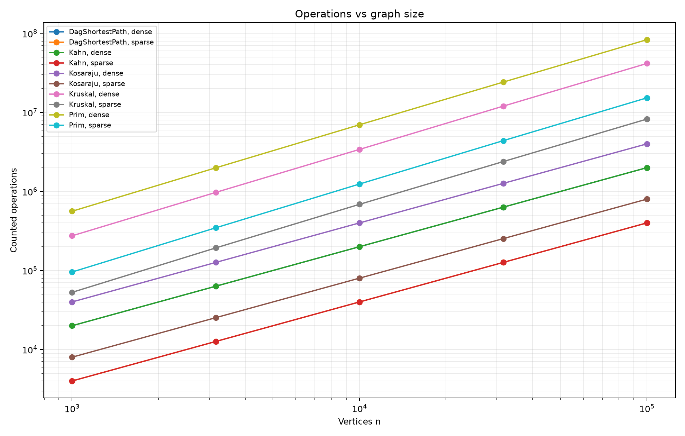
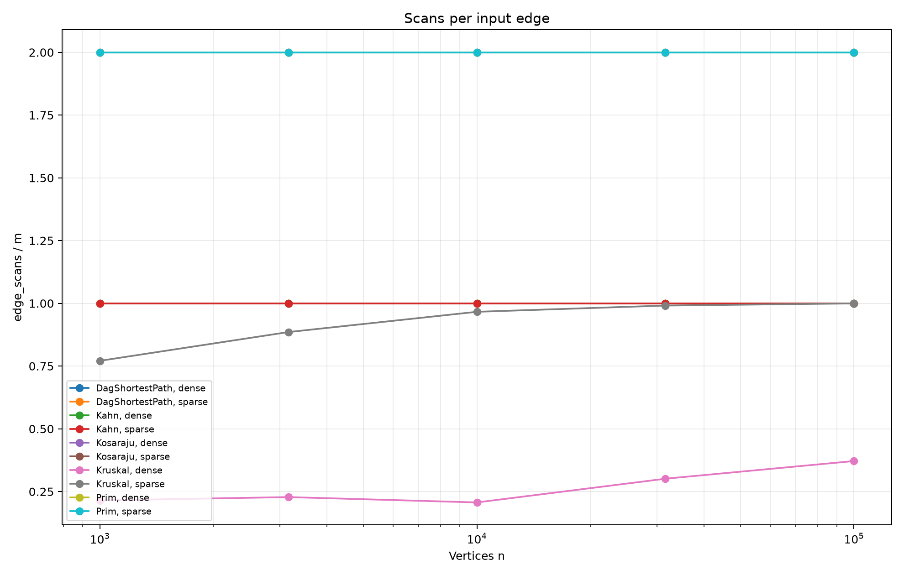
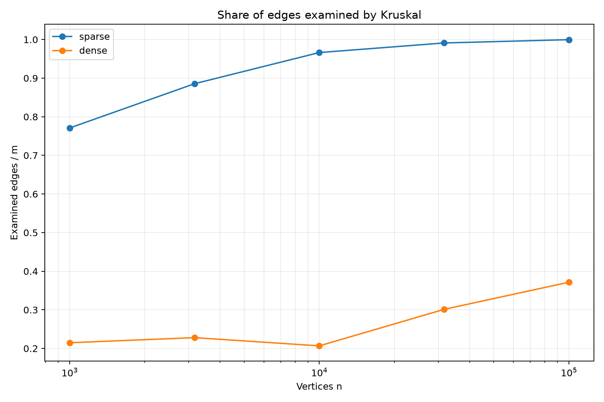

# Assignment 3 — Graph Algorithms

## 1. Representation and implementation

The project uses one adjacency-list Graph class for directed
and undirected graphs.

An undirected input edge is stored once in the original edge
list and twice in adjacency lists.

Edge weights are int. Distances, total weights and operation
counters are long.

DFS is iterative. No recursive graph traversal is used.

## 2. Complexity

Let V be the number of vertices and E the number of input edges.

| Algorithm | Time | Extra space | Justification |
|---|---|---|---|
| DSU find/union | O(alpha(V)) amortized | O(V) for DSU; O(1) per operation | Union by size and path compression |
| Kruskal | O(V + E log E) | O(V + E) | Initialization, sorting, DSU and result edges |
| Lazy Prim | O(V + E log(E + 1)) | O(V + E) | Every vertex is visited and candidate edges use a heap |
| Kosaraju | O(V + E) | O(V + E) | Two DFS passes, reverse graph and explicit stacks |
| Kahn | O(V + E) | O(V) | In-degree preparation and queue traversal |
| DAG shortest paths | O(V + E) | O(V) | Topological sorting and one relaxation pass |

The input graph is excluded from extra-space estimates.
Kruskal's sorted copy and Kosaraju's reversed graph are included.

Prim uses a lazy edge priority queue. Its queue can contain
O(E) entries, which is why its stated bound uses log E.

## 3. Correctness of MST algorithms

Consider a cut that separates a graph component into two sets.
Let e be a minimum-weight edge crossing this cut.
Take a minimum spanning tree T.
If T contains e, adding e is already compatible with an MST.
Otherwise, adding e creates a cycle containing another crossing
edge f.
Because e is a lightest crossing edge, replacing f with e
does not increase the total weight.
Kruskal applies this property to cuts between DSU components,
while Prim applies it to the cut between visited and unvisited
vertices; processing disconnected components separately
produces a minimum spanning forest.

## 4. Correctness of DAG shortest paths

Every edge of a DAG goes forward in a topological order.
All zero-in-degree vertices receive distance zero,
which is equivalent to adding a virtual super-source.
Before a vertex is processed, every possible predecessor
has already been processed.
Therefore, every incoming candidate path has already been
considered.
By induction over the topological order, the vertex's
distance is final when its outgoing edges are relaxed.
Each edge needs only one relaxation.
Negative weights are safe because a DAG has no cycles,
and therefore has no negative cycles.

## 5. Counter interpretation

DSU operations count find calls and successful unions.

Weight comparisons are counted inside the sorting and
priority-queue comparators.

Kosaraju counts edges examined by its two DFS passes:
edge_scans = 2E.

Kahn counts edges examined while removing vertices:
edge_scans = E for a DAG.

DAG shortest paths count the relaxation pass:
edge_scans = E.

Preparatory work is included in elapsed time but excluded
from these specific traversal counters.

Prim examines both adjacency entries of an undirected edge:
edge_scans = 2E.

The normalized measurements and fitted slopes are generated
in results/analysis.md.

A stable normalized counter supports the expected growth
on the tested graph family. It does not replace the
theoretical complexity argument.

## 6. Which algorithm when

| Situation | Choice | Reason |
|---|---|---|
| Connectivity under repeated unions | DSU | Efficient merging and membership checks |
| Undirected weighted graph supplied as an edge list | Kruskal | Sorting and DSU fit this representation |
| Undirected weighted graph supplied as adjacency lists | Prim | Grows the forest through neighboring edges |
| Very dense simple graph with a matrix | Consider O(V²) Prim | Can avoid heap overhead; not implemented here |
| Directed graph with possible cycles | Kosaraju | Identifies strongly connected groups |
| Dependency ordering | Kahn | Produces an order or detects a cycle |
| Shortest paths in a DAG | DAG relaxation | Linear time and support for negative weights |
| General graph with non-negative weights | Dijkstra | Applicable outside DAGs; not implemented here |
| General graph with negative weights | Bellman–Ford | Handles negative edges and detects reachable negative cycles |

Graph density alone does not decide between Kruskal
and heap-based Prim. Representation, queue behavior and
measured operations also matter.

## 7. Experimental results

Insert the generated normalization tables and slope table
from results/analysis.md after running the full benchmark.

Include the observed MST weights, SCC counts and distance
sums, and state whether the PDF reference checks passed.

Kruskal's sorting logarithm should be investigated through
weight comparisons. Its post-sort edge scans do not include
sorting and cannot alone demonstrate E log E growth.

## 8. Wall-clock time

Insert the measured time ranges from results/analysis.md
and describe the observed behavior.

Times are medians of five runs after one discarded warmup.
They depend on hardware, JVM compilation, garbage collection
and background activity.

Operation counters are the primary reproducible evidence.
Elapsed time describes the tested execution environment.